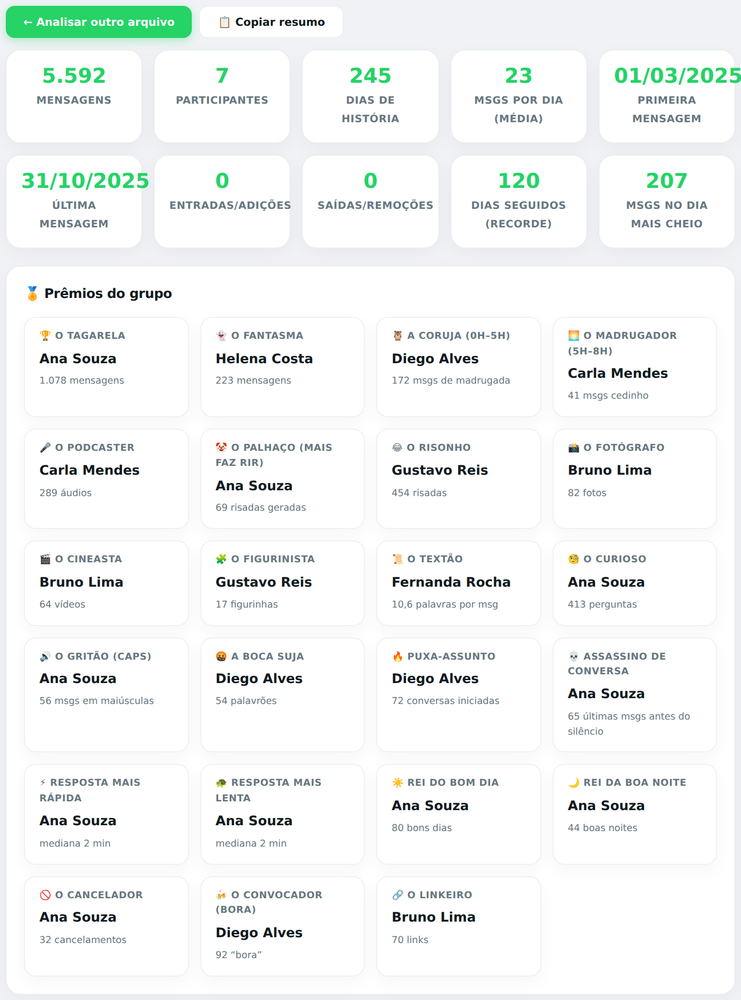
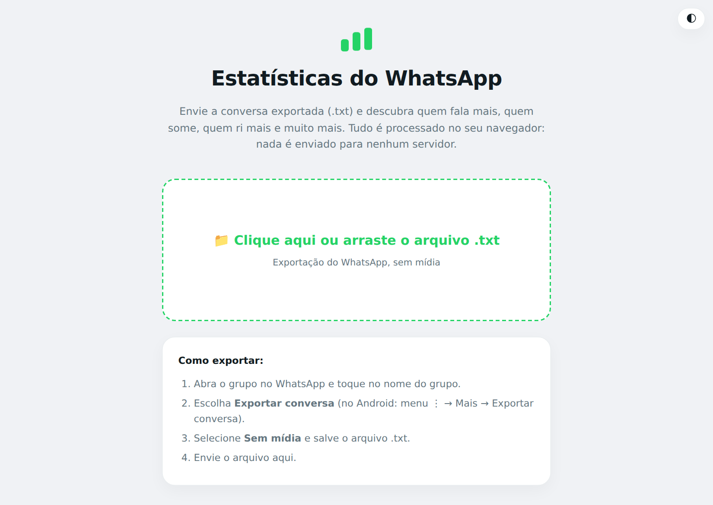
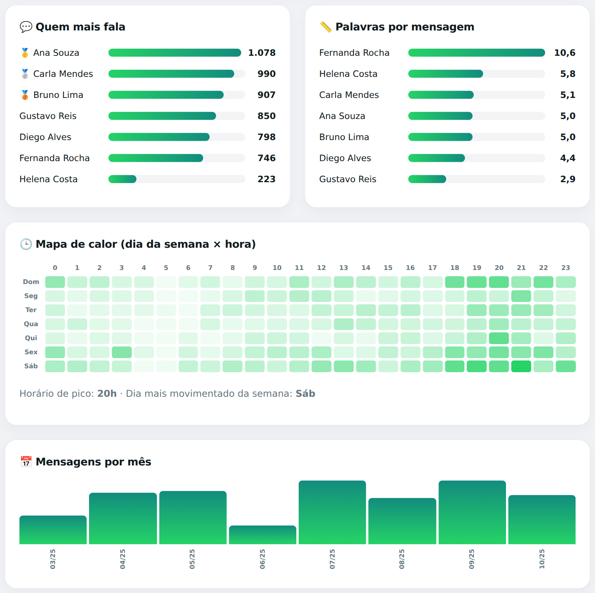
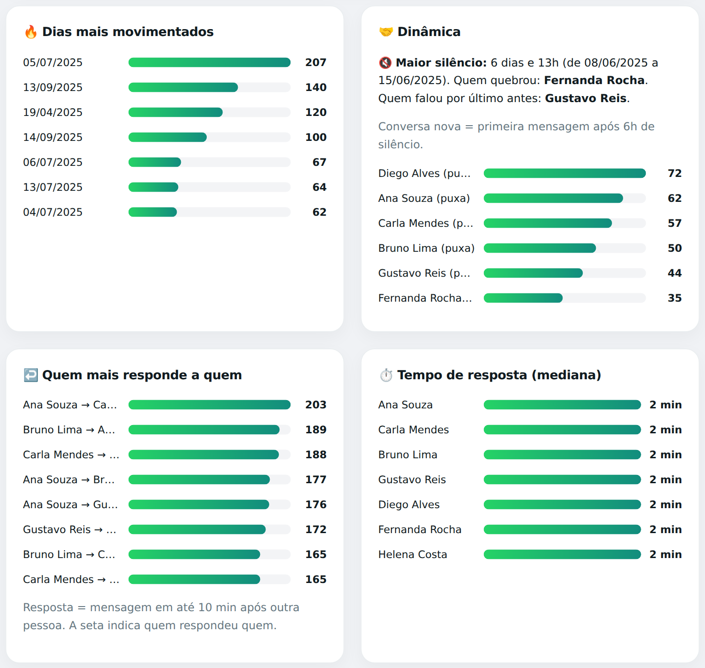
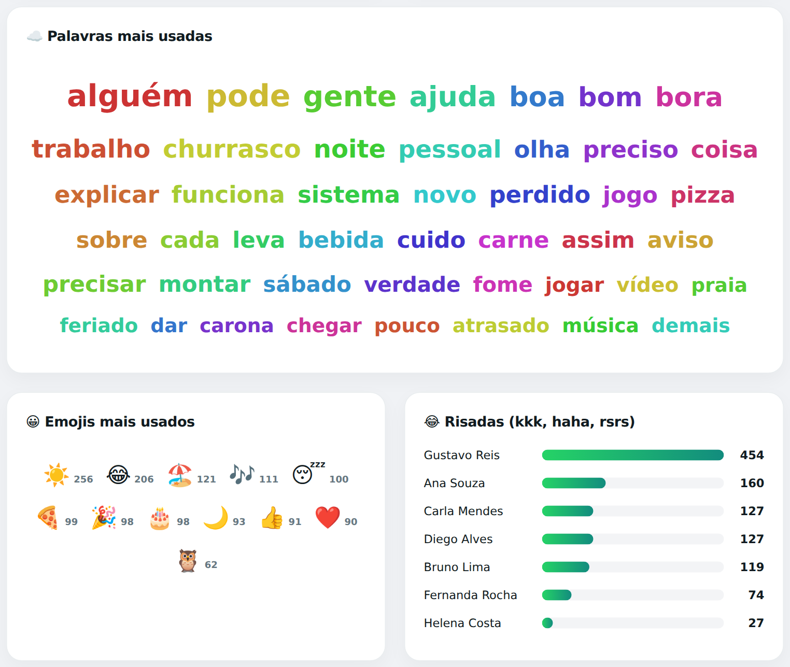
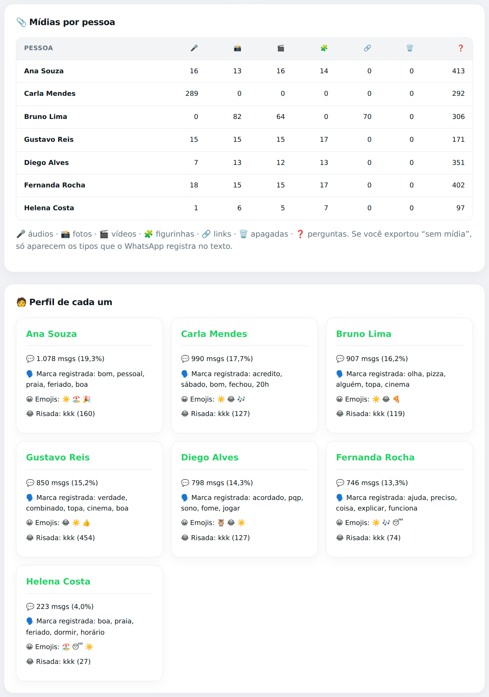
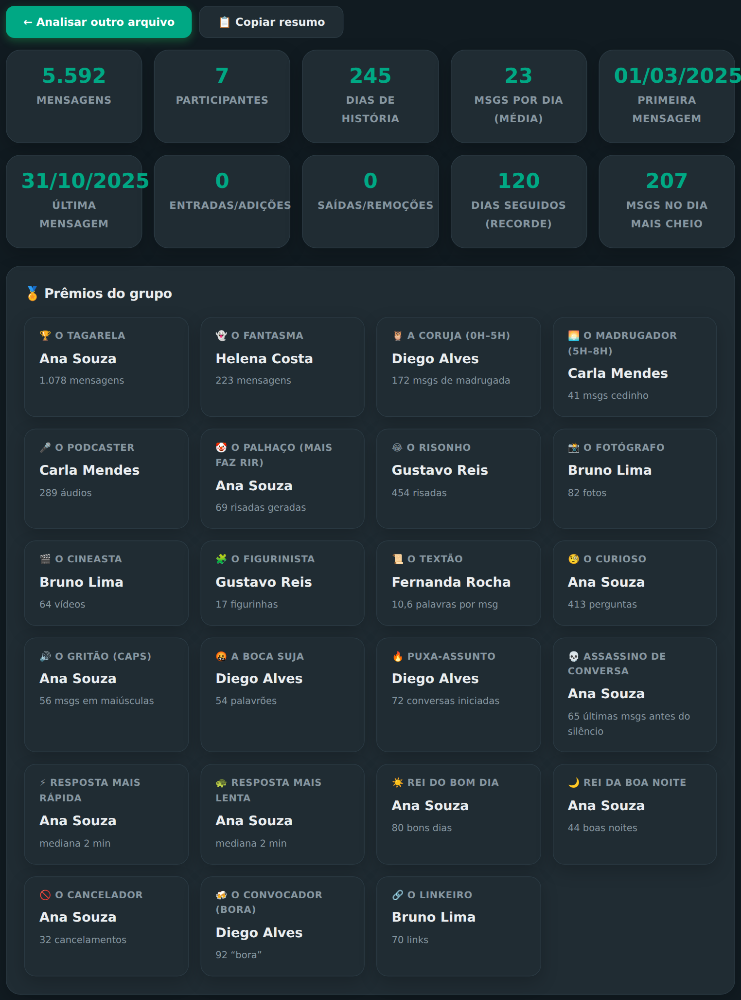

<div align="center">

# 📊 Estatísticas do WhatsApp

**Descubra quem fala mais, quem some, quem ri mais e muito mais no seu grupo.**
Envie a conversa exportada e receba um relatório completo, bonito e sem enviar nada para servidor nenhum.

<br>

[](https://SEU-USUARIO.github.io/whatsapp-stats/)


<br>



</div>

---

## ✨ O que ele mostra

| | |
|---|---|
| 🏅 **Prêmios do grupo** | Tagarela, Fantasma, Coruja, Madrugador, Podcaster, Palhaço, Fotógrafo, Textão, Boca Suja, Cancelador, Convocador e mais |
| 💬 **Rankings** | Quem mais fala (com 🥇🥈🥉) e palavras por mensagem |
| 🕒 **Mapa de calor** | Dia da semana × hora, com horário de pico |
| 📅 **Linha do tempo** | Mensagens por mês e os dias mais movimentados |
| 🤝 **Dinâmica** | Maior silêncio, quem puxa assunto e quem responde a quem |
| ⏱️ **Tempo de resposta** | Mediana de cada pessoa |
| ☁️ **Palavras, emojis e risadas** | Nuvem de palavras, emojis favoritos e quem mais ri (kkk, haha, rsrs) |
| 📎 **Mídias por pessoa** | Áudios, fotos, vídeos, figurinhas, links e mensagens apagadas |
| 🧑 **Perfil de cada um** | Marca registrada, emojis e risada de cada participante |
| 🔥 **Recordes** | Maior sequência de dias seguidos e o dia mais cheio do grupo |

Tem ainda **tema claro/escuro** e o botão **📋 Copiar resumo**, que gera um texto pronto para colar no grupo.

---

## 🖼️ Telas

> Os prints abaixo usam uma conversa **fictícia**, criada só para demonstração.

<div align="center">

### Tela inicial


### Rankings e mapa de calor


### Dinâmica do grupo


### Palavras, emojis e risadas


### Mídias e perfis


### Tema escuro


</div>

---

## 🚀 Como usar

1. **Exporte a conversa** no WhatsApp:
   - **iPhone:** abra o grupo → toque no nome do grupo → **Exportar conversa**.
   - **Android:** abra o grupo → menu **⋮** → **Mais** → **Exportar conversa**.
2. Escolha **Sem mídia** e salve o arquivo `.txt`.
3. Abra o site, **clique ou arraste** o `.txt` para a área verde e pronto.

> Se o WhatsApp gerar um `.zip`, extraia e envie o `.txt` que está dentro.

---

## 🔒 Privacidade

Tudo é processado **no seu navegador**. O arquivo da conversa **não é enviado** para nenhum servidor, não há cadastro e não há rastreamento. A única requisição externa é a fonte do Google Fonts.

---

## 💻 Rodando localmente

Não precisa instalar nada. Basta baixar o repositório e abrir o `index.html` no navegador.

```bash
git clone https://github.com/SEU-USUARIO/whatsapp-stats.git
cd whatsapp-stats
# abra o index.html no navegador, ou, se preferir um servidor local:
python3 -m http.server 8000   # depois acesse http://localhost:8000
```

---

## 🌐 Publicando no GitHub Pages

1. Suba os arquivos para um repositório **público**.
2. Vá em **Settings → Pages**.
3. Em **Build and deployment**, escolha **Deploy from a branch**, branch `main` e pasta `/ (root)`.
4. Salve e aguarde de 1 a 2 minutos. O endereço será `https://SEU-USUARIO.github.io/NOME-DO-REPO/`.

---

## ⚙️ Como funciona

Um único arquivo HTML, com CSS e JavaScript puros e sem bibliotecas.

- **Leitura (parser):** reconhece os formatos de exportação do Android e do iPhone, com data `dd/mm/aaaa` ou `mm/dd/aaaa` (detectada automaticamente), hora em 24h ou AM/PM, com ou sem segundos.
- **Análise:** uma passada pelas mensagens calcula contagens, horários, respostas, palavras, emojis e risadas.
- **Visualização:** os gráficos são feitos em HTML e CSS, sem canvas nem libs de gráficos.

---

## ❓ Problemas comuns

<details>
<summary><b>"Não encontrei mensagens neste arquivo"</b></summary>

Confira se o arquivo é mesmo a conversa exportada do WhatsApp (`.txt`) e se não é o `.zip` ou outro tipo de arquivo.
</details>

<details>
<summary><b>Os prêmios de áudio, foto ou vídeo não aparecem</b></summary>

O tipo de mídia só é identificado quando o WhatsApp registra isso no texto da exportação. Se não aparecer, tente exportar a conversa de outra forma (com ou sem mídia) e veja qual funciona melhor no seu aparelho.
</details>

<details>
<summary><b>Alguns participantes aparecem como número de telefone</b></summary>

É assim que o WhatsApp registra quem não está salvo nos seus contatos. O site usa exatamente o nome que vem no arquivo.
</details>

<details>
<summary><b>Meu grupo é muito grande</b></summary>

Os rankings mostram os 15 primeiros colocados. A análise considera todos os participantes.
</details>

---

## 🗂️ Estrutura do projeto

```text
whatsapp-stats/
├── index.html      # o site inteiro (HTML + CSS + JS)
├── README.md
└── docs/           # prints usados neste README
```

---

## 🤝 Contribuindo

Ideias e melhorias são bem-vindas! Abra uma *issue* ou envie um *pull request*. Algumas sugestões:

- [ ] Filtrar a análise por período (ex.: só 2025)
- [ ] Comparar duas pessoas lado a lado
- [ ] Exportar o relatório como imagem
- [ ] Novos prêmios

---

<div align="center">

Feito com 💚 para analisar o caos dos grupos de WhatsApp.

</div>
